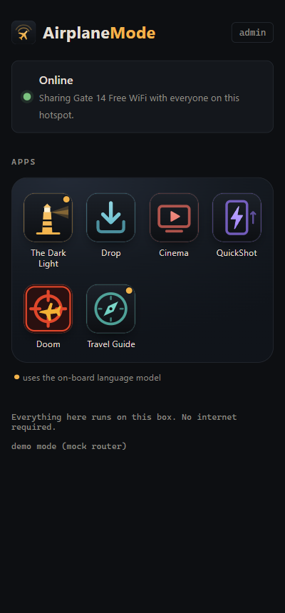
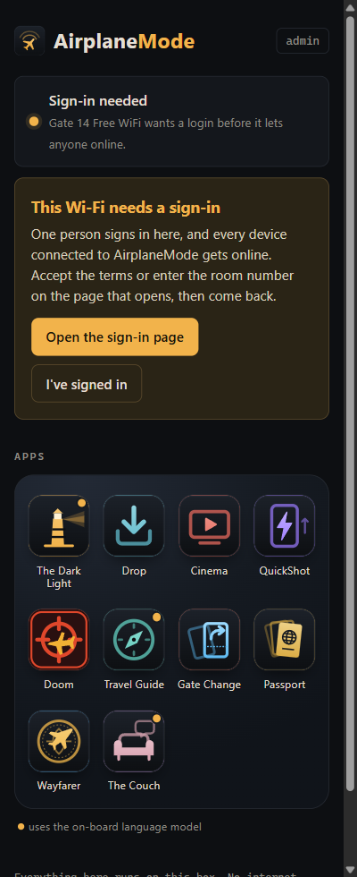
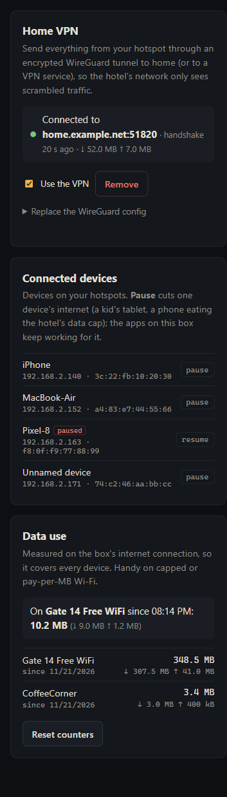
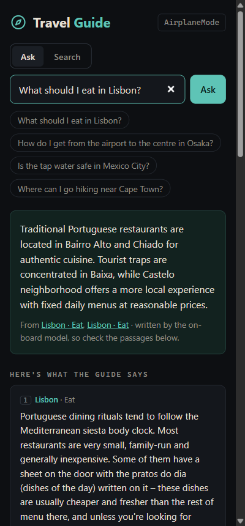
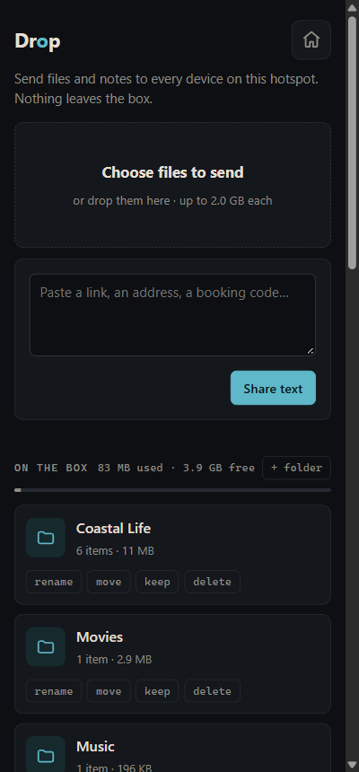
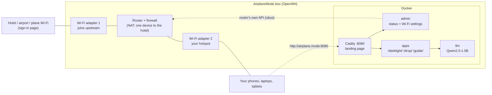

<p align="center"></p>

# AirplaneMode

**A travel router that brings its own apps.** AirplaneMode turns a small router into a
private hotspot for your devices that:

- **joins the hotel, airport or plane Wi-Fi once, and shares it.** One person gets through
  the "accept the terms" page, and every phone, laptop and tablet on your hotspot is online.
  No more signing each device in, or paying per device.
- **remembers networks and reconnects by itself.** Back at the same hotel or café, it rejoins
  without anyone touching it. Plug in a room's Ethernet cable and that's used first.
- **broadcasts your own Wi-Fi network,** with the same name and password everywhere you go,
  so your devices connect automatically in every new place.
- **runs apps locally,** games and tools that work with no internet at all, including a small
  language model built into the box.
- **sends everything through your home VPN** (WireGuard) if you want, so the hotel's
  network only sees encrypted traffic.
- **shows who's connected and how much data you've used,** and lets you pause one device's
  internet (a tablet streaming all night on a capped plane Wi-Fi).
- **has a simple admin panel** for picking the network to join, the VPN, devices, your
  hotspots and which apps are on the menu, from any phone.

<p align="center">
  
  
  
</p>
<p align="center">
  
  
</p>

<sub>Screenshots from the laptop dev stack (mock router); real hardware not tested yet.</sub>

This is the **platform repo**: the landing page, admin panel, shared services, hardware
profiles and design docs. Each app lives in its own repo and plugs in as a container image.

| Repo | What it is |
|---|---|
| [airplanemode](https://github.com/jessewolcott/airplanemode) | this repo: landing page, admin panel, router control, shared model, docs |
| [airplanemode-darklight](https://github.com/jessewolcott/airplanemode-darklight) | *The Dark Light*, text adventures narrated by the on-board model |
| [airplanemode-drop](https://github.com/jessewolcott/airplanemode-drop) | *Drop*: pass files and notes between every device on the hotspot, keep movies for the flight |
| [airplanemode-guide](https://github.com/jessewolcott/airplanemode-guide) | *Travel Guide*: all of Wikivoyage offline, plus "ask the guide" with the on-board model |
| [airplanemode-cinema](https://github.com/jessewolcott/airplanemode-cinema) | *Cinema*: plays the films, shows and music on Drop, shelved by folder, each device resuming where it left off |
| [airplanemode-site](https://github.com/jessewolcott/airplanemode-site) | the homepage and one-line installer (not hosted yet) |

More app ideas (offline maps, a translator, a cinema, a trip kit…) are in
[docs/app-ideas.md](docs/app-ideas.md).

## How it works



- **Sharing one sign-in.** All your devices reach the hotel network through the router, so
  the hotel sees a single device. Usually the first phone that joins your hotspot shows the
  hotel's own "Sign in to network" popup, because its connectivity check passes straight
  through the box (like a GL.iNet). As a backup, the landing page runs the same check and
  shows **"This Wi-Fi needs a sign-in"** with a button that opens the page. One person signs
  in, and everyone is online. For hotels that tie the login to one device, the admin panel
  can make the router use your phone's MAC address (*clone MAC*). The setup script turns
  off DNS rebind protection, which would otherwise block many hotel sign-in pages
  ([decision 0009](docs/decisions/0009-connectivity-supervisor.md)).
- **Staying connected.** A supervisor checks the uplinks every 30 seconds:
  - **Ethernet first.** A cable in the WAN port always wins over Wi-Fi.
  - **Saved networks.** With no uplink, the box scans and joins the strongest network it
    has been on before. A network that keeps failing (say, a changed password) is skipped
    for 10 minutes.
  - **Offline popup.** With no uplink at all, phones that join your hotspot get the landing
    page as a sign-in screen, so people find the apps and the *Get online* button without
    knowing the address. It switches off the moment any uplink is back, so it never gets
    in front of a hotel's own sign-in page.
- **Home VPN.** Paste a WireGuard config (from your home router, wg-easy, PiVPN or a VPN
  service) into the admin panel. Everything from your hotspot then goes through the tunnel.
  The private key stays on the box. A VPN can't get past a hotel sign-in page, so at a new
  hotel turn it off, sign in, and turn it back on; the landing page reminds you
  ([decision 0010](docs/decisions/0010-home-vpn-devices-data-use.md)).
- **Devices and data use.** The admin panel lists devices on your hotspots and can pause
  one device's internet (it keeps the box's apps). It also counts data used per network,
  measured on the box's uplink so it covers everyone.
- **Changing Wi-Fi settings safely.** The admin service doesn't run with special
  privileges. It changes settings through the router's own management API, the same one the
  router's built-in admin page (LuCI) uses. It refuses to turn off your last working hotspot,
  so you can't lock yourself out.
- **Offline first.** Everything is downloaded ahead of time (`scripts/update.sh`, while
  online). The apps work in airplane mode, hence the name.

## Hardware you need

### Recommended: NanoPi R6S (full: everything, including the language model)

| Part | Why | Notes |
|---|---|---|
| **FriendlyElec NanoPi R6S** (8 GB RAM, 32 GB eMMC) | the box: RK3588S, two 2.5 GbE ports, enough RAM for the model | Comes in a metal case that doubles as the heatsink. |
| **2 USB Wi-Fi adapters, MediaTek chipset** | **The R6S has no built-in Wi-Fi.** One adapter joins the hotel network, the other runs your hotspot. | Pick chipsets with drivers built into OpenWrt (mt76): **MT7612U** (Wi-Fi 5, well proven in both modes, e.g. ALFA AWUS036ACM) or **MT7921AU** (Wi-Fi 6, newer). Avoid Realtek adapters, whose drivers are hit and miss in hotspot mode. |
| **USB-C power, 5 V / 3 A or better** | the R6S plus two adapters | A good USB-C PD power bank works too. |
| *Optional:* short USB extension cable | moves an adapter off the metal case | Better range, and keeps the two adapters apart. |

**The build this project is being tested on** (bought, not yet verified: see
[docs/testing.md](docs/testing.md)):

| Part | Job |
|---|---|
| NanoPi R6S, 8 GB, with the metal case | the box |
| ALFA AWUS036ACHM (MT7610U, mt76x0u driver) | joins the hotel network (upstream); long range, low power |
| ALFA AWUS036ACM (MT7612U, mt76x2u driver) | your hotspot; the best-proven MediaTek chip in AP mode |
| Short USB extension cable | moves one adapter away from the case and the other adapter |
| 5 V / 3 A USB-C power supply | power for the box plus both adapters |

Put the hotspot adapter (AWUS036ACM) on the **USB 3.0** port.

The R6S has one USB 3.0 and one USB 2.0 port, so both adapters fit without a hub. One
adapter can do both jobs, but both networks then share one channel and get slower.

### Lite: GL.iNet travel routers (no language model)

GL.iNet routers already have Wi-Fi and their own repeater mode. AirplaneMode can run on
**arm64** models with Docker installed on USB/SD storage, ideally with **1 GB of RAM**. Apps
run in their plain mode, without the model. *Not yet tested on real GL.iNet hardware.* See
[docs/hardware.md](docs/hardware.md) for the caveats.

## What's tested so far

| Piece | Status |
|---|---|
| Landing page, app menu, sign-in flow, admin panel | tested end to end in the browser against the mock router |
| Apps on the menu (admin switch), Drop folders + "downloads off", Cinema from Drop | automated tests; checked end to end in the browser on the dev stack |
| Admin API (auth, validation, lockout guard, captive flow) | automated tests, run in CI |
| Router control (join, MAC clone, firewall, hotspots) | tested against a real OpenWrt 24.10 API in Docker (`admin/tests/test_openwrt_live.py`) |
| Limited router login (`scripts/router-setup.sh`) | tested on real OpenWrt 24.10: every admin feature works, and 8 out-of-scope calls are refused |
| Auto-join, Ethernet priority, offline popup (supervisor logic) | automated tests against the mock router; travel simulated in the browser |
| Router side of those (route metrics, rebind off, popup DNS + firewall rule) | tested on real OpenWrt 24.10; the generated firewall ruleset passes nftables' own syntax check |
| Home VPN, device pause, data use (logic) | automated tests against the mock router; panel checked in the browser |
| Router side of those (WireGuard interface + zone, pause rules, ACL) | tested on real OpenWrt 24.10 in Docker; ruleset passes nftables' syntax check |
| Live link status, scanning, reloading Wi-Fi on real radios, a real tunnel, DHCP leases, byte counters | **needs a real device:** see the checklist in [docs/testing.md](docs/testing.md) |
| Full stack with the 1.5B model | tested on a PC with Docker Desktop; speed on the R6S not yet measured |

## Set it up

**The easy way:** after flashing and the first login (see
[docs/hardware.md](docs/hardware.md) and FriendlyElec's wiki), run the installer from
[airplanemode-site](https://github.com/jessewolcott/airplanemode-site) on the router as
root. It does steps 5 and 6 below for you, checks the router first, and prints the admin
password at the end:

```sh
command -v curl >/dev/null || { opkg update && opkg install curl || apk add -U curl; } >/dev/null 2>&1
curl -fsSL https://raw.githubusercontent.com/jessewolcott/airplanemode-site/main/install.sh | sh
```

A homepage with a step-by-step guide and a command builder is coming, on its own server.

**By hand:**

1. **Flash FriendlyWrt** to the R6S's eMMC, following FriendlyElec's NanoPi R6S wiki.
   FriendlyWrt is OpenWrt with Docker included.
2. **Plug in both Wi-Fi adapters**, then check that two radios show up in the router's admin
   page (LuCI → Network → Wireless).
3. **Set a root password** in LuCI (System → Administration), if you haven't already. It
   stays yours: AirplaneMode gets its own, more limited login in step 5.
4. **Get the box online once,** by Ethernet or by joining a Wi-Fi network in LuCI. Setup
   downloads about 1.8 GB of images, model and Wikivoyage files.
5. **Install AirplaneMode** from the router's shell (SSH in as root):

   ```sh
   git clone https://github.com/jessewolcott/airplanemode.git /opt/airplanemode
   cd /opt/airplanemode
   cp hardware/nanopi-r6s.env .env           # or hardware/glinet.env
   # if your LAN isn't the default subnet, also fix LAN_IP in .env
   sh scripts/router-setup.sh                # prepares the router (see below)
   sh scripts/update.sh
   ```

   `router-setup.sh` prepares the router, and is safe to run again:
   - creates a router login called `airplanemode` that can change Wi-Fi settings and
     nothing else, and saves its random password in `.env` (re-running rotates it);
   - turns off DNS rebind protection so hotel sign-in pages load (keep it with
     `KEEP_REBIND_PROTECTION=1`);
   - points the name **`airplane.mode`** at the box;
   - makes the Ethernet WAN preferred over Wi-Fi;
   - installs WireGuard support for the home VPN, if it's missing.

   On the first run, `update.sh` generates an **admin password** for the admin panel,
   prints it and saves it in `.env`. Write it down.
6. **Open `http://airplane.mode:8080/admin/`**, sign in, and rename your hotspot and set its
   password. Your devices remember it from then on.

## Using it on a trip

1. Power the box on and connect your devices to **your** hotspot as usual. If the room has
   an Ethernet port, plug it into the box's **WAN** port: it's used automatically.
2. Somewhere you've been before? The box rejoins that network by itself within about a
   minute.
3. Somewhere new? Your phone shows the AirplaneMode page as a sign-in screen (or open
   **`http://airplane.mode:8080`**). Tap **Choose a Wi-Fi network**, sign in to admin, pick
   the hotel network, enter its password if it has one, then **Connect**. It's remembered
   for next time.
4. If the hotel needs a sign-in, the first phone usually pops up the hotel's own sign-in
   page. If not, the landing page says *Sign-in needed*: tap **Open the sign-in page**,
   accept the terms or enter your room number, then tap **I've signed in**. Everyone on
   your hotspot is now online.
5. No Wi-Fi at all, like on a plane without it? The apps still work.

Run `sh scripts/update.sh` occasionally while online to pick up new versions.

## Develop on a laptop

Everything runs on Docker Desktop. The admin service uses a **mock router** with fake nearby
networks and a fake hotel sign-in page, so you can try the whole flow without hardware:

```sh
git clone https://github.com/jessewolcott/airplanemode.git
git clone https://github.com/jessewolcott/airplanemode-darklight.git
cd airplanemode
cp hardware/nanopi-r6s.env .env
docker compose -f compose.yaml -f compose.dev.yaml up -d --build
# http://localhost:8080  (admin password in dev mode: "dev")
```

In VS Code, open `airplanemode.code-workspace`: it loads this repo and the app repos side
by side, recommends the extensions, and has tasks (*Terminal → Run Task*) for the dev stack,
tests and config checks. Contributors using Claude Code: see `CLAUDE.md`.

Join `Harbor_Hotel_Guest` in the admin panel to see the sign-in flow. Simulate travel with
`curl -X POST localhost:8080/api/mock/world -H 'Content-Type: application/json' -d '{"in_range": []}'`
(walk away from every network), `{"in_range": ["CoffeeCorner"]}`, or `{"ethernet": true}`. After editing the
`Caddyfile`, run `docker compose restart proxy`. Tests: `python admin/tests/test_admin.py`.

## Repo layout

```
compose.yaml          the whole box: proxy, admin, shared model, apps (pinned versions)
compose.dev.yaml      laptop override: mock router, apps built from sibling checkouts
Caddyfile             routes: / landing page, /api + /admin admin service, /<app>/ apps
portal/               landing page + apps.json (the app menu)
admin/                admin service: status, captive-portal check, Wi-Fi control, admin UI
hardware/*.env        per-device settings (copy one to .env, then add your secrets)
scripts/update.sh     pull, build, start, pre-download the model while online
scripts/router-setup.sh  prepare the router: Wi-Fi-only login, DNS, Ethernet priority (as root)
router/               the access list for that login
docs/app-contract.md  what an app must do to plug in
docs/app-ideas.md     apps worth building next
docs/hardware.md      device setup details and caveats
docs/testing.md       how to test, and the on-device checklist
docs/decisions/       why things are the way they are
```

## Adding an app

1. Create `airplanemode-<name>` following [docs/app-contract.md](docs/app-contract.md).
2. Tag a release so its CI publishes the arm64 image, and make the package public on GitHub.
3. Here: add the service to `compose.yaml`, a route to `Caddyfile`, and an entry to
   `portal/apps.json`. The `check` workflow fails if any of the three is missing.

## Security notes

- Only the front door (port 8080) is published, and it's bound to the router's **LAN
  address** (`LAN_IP` in `.env`), not to every interface. Docker's own firewall rules can
  bypass OpenWrt's, so this binding is what keeps it off the hotel network. The model and
  the apps aren't reachable directly. Check this on your device (see
  [docs/testing.md](docs/testing.md)).
- The admin service never uses the router's root login. It signs in as `airplanemode`,
  whose access list ([router/rpcd-acl-airplanemode.json](router/rpcd-acl-airplanemode.json))
  covers only the wireless, network, firewall and DNS settings, Wi-Fi, interface, DHCP-lease
  and WireGuard status, and applying changes. It can't run commands, read files, or touch system settings, SSH or passwords.
  This is tested against real OpenWrt ([decision 0008](docs/decisions/0008-least-privilege-router-login.md)).
- `.env` holds the admin password and that limited router password. It's mode 600 and
  ignored by git. Anyone who can sign in to the admin panel can change your Wi-Fi settings,
  so pick a real password for your hotspot.
- The admin panel uses an HttpOnly, same-site session cookie and a custom request header
  against cross-site requests, and slows down wrong-password attempts (one guess at a time,
  1.5 s each). Sessions are kept in memory, so restarting the admin service signs everyone out.
- DNS rebind protection is **off**, because hotel sign-in pages need it off. That weakens a
  defence against malicious websites reaching devices on your LAN by name. Keep it on with
  `KEEP_REBIND_PROTECTION=1 sh scripts/router-setup.sh` if you rarely use hotel Wi-Fi with
  sign-in pages ([decision 0009](docs/decisions/0009-connectivity-supervisor.md)).
- Saved networks' passwords are kept in the admin service's data volume (mode 600), the same
  way OpenWrt itself stores Wi-Fi passwords in its config.
- It's plain HTTP on your own LAN: there's no public name to get a certificate for. See
  [decision 0004](docs/decisions/0004-offline-first.md).
